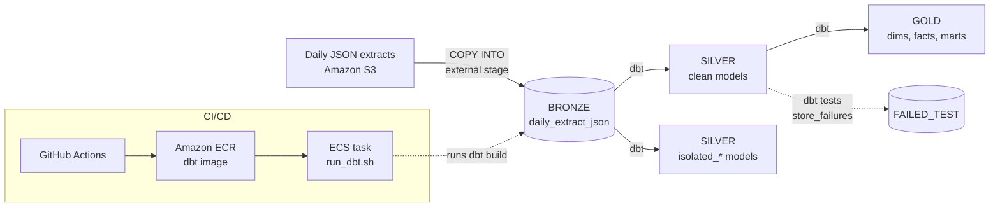

# Lonestar Assurance dbt-Platform

A Snowflake analytics platform for an insurance company. Daily JSON extracts land in S3, are loaded into a Snowflake bronze layer, and are transformed by dbt Core into tested silver and gold layers that answer business questions on exposure, agent performance, claims operations, cross-sell, and high-value asset risk.

The repo covers:

- **Analytics engineering:** a dbt project with bronze sources, silver cleaning and data-quality isolation, and a gold star schema with business marts.
- **Platform engineering:** Terraform for Snowflake objects, a Dockerised dbt runtime, and GitHub Actions for CI/CD.

---
## Overview

| Section | What it covers |
|---|---|
| [Architecture](#architecture) | How data flows from S3 through bronze, silver, and gold, and how CI/CD runs dbt |
| [Repository structure](#repository-structure) | Folder layout of the repo and of the dbt project |
| [Data model](#data-model) | The layers, from raw bronze to the gold star schema |
| &nbsp;&nbsp;↳ [Bronze](#bronze) | Raw JSON loads with file metadata |
| &nbsp;&nbsp;↳ [Silver](#silver) | Flattened, typed, deduplicated entities |
| &nbsp;&nbsp;↳ [Data-quality isolation](#data-quality-isolation) | Rules for moving bad rows into `isolated_*` models |
| &nbsp;&nbsp;↳ [Gold](#gold) | Dimensions and facts of the star schema |
| [Business questions](#business-questions) | The businessquestions the marts answer |
| [Getting started](#getting-started) | Prerequisites, environment variables, setup, and run commands |
| [Testing](#testing) | Generic and singular tests, and where failing rows are stored |
| [Linting](#linting) | SQLFluff configuration and usage |
| [CI/CD](#cicd) | GitHub Actions workflows and the ECS runtime |
| [Infrastructure](#infrastructure) | Terraform modules for Snowflake users and warehouses |
| [Environments](#environments) | Test and production targets and their helper scripts |

---

## Architecture



| Layer | Schema | Built by | Purpose |
|---|---|---|---|
| Bronze | `BRONZE` | `COPY INTO` | Raw JSON, one row per extract file record, with file metadata |
| Silver | `SILVER` | dbt | Flattened, typed, deduplicated entities, plus rows that failed key checks |
| Gold | `GOLD` | dbt | Star schema and business marts |
| Test failures | `FAILED_TEST` | dbt (`store_failures`) | Rows that failed each data test |

---

## Repository structure

```
elite-lonestar-assurance-dbt-platform/
├── .github/workflows/
│   ├── dbt-ci.yml            # dbt checks on pull requests
│   ├── dbt-cd.yml            # build and publish the dbt image
│   └── terraform-ci.yml      # Terraform checks on pull requests
├── dbt-transformations/
│   ├── lonestar/             # the dbt project (see below)
│   ├── Dockerfile            # dbt runtime image
│   ├── requirements.txt      # pinned Python dependencies
│   ├── run_dbt.sh            # container default entrypoint
│   ├── .sqlfluff             # SQL lint configuration
│   ├── .sqlfluffignore
│   └── .dockerignore
├── infrastructures/
│   ├── modules/
│   │   ├── snowflake_users/      # Snowflake users and roles
│   │   └── snowflake_warehouse/  # Snowflake warehouses
│   ├── production/           # production environment
│   └── test/                 # test environment
└── README.md
```

### dbt project (`dbt-transformations/lonestar/`)

```
lonestar/
├── dbt_project.yml
├── models/
│   ├── bronze/
│   │   └── _bronze__sources.yml
│   ├── silver/
│   │   ├── _silver__models.yml
│   │   ├── agents.sql, customers.sql
│   │   ├── stg_policies.sql, stg_assets.sql, stg_claims.sql
│   │   ├── policies.sql, assets.sql, claims.sql
│   │   └── isolated_policies.sql, isolated_assets.sql, isolated_claims.sql
│   └── gold/
│       ├── _gold__models.yml
│       ├── dim_agent.sql, dim_asset.sql, dim_customer.sql
│       ├── fact_policy.sql, fact_claim.sql
│       └── marts/
└── tests/
    └── claims_asset_policy_match.sql
```

---

## Data model

### Bronze

Daily extracts (`data_file.json`) are loaded from an external S3 stage into `daily_extract_json`. Each file holds arrays for five entities: `agents`, `customers`, `policies`, `assets`, `claims`.

| Column | Description |
|---|---|
| `json_data` | The record as `VARIANT` |
| `file_name` | S3 path of the source file |
| `file_row_number` | Row position within the file |
| `file_last_modified` | When the file landed in S3 (used to pick the newest copy of a record) |
| `loaded_at` | When Snowflake loaded the row |

Load with a transformation `COPY INTO`, which also skips files already loaded:

```sql
COPY INTO LONESTAR_PROD_DATABASE.BRONZE.daily_extract_json
    (json_data, file_name, file_row_number, file_last_modified, loaded_at)
FROM (
    SELECT
        $1,
        METADATA$FILENAME,
        METADATA$FILE_ROW_NUMBER,
        METADATA$FILE_LAST_MODIFIED,
        CURRENT_TIMESTAMP()
    FROM @LONESTAR_PROD_DATABASE.BRONZE.LONESTAR_EXTERNALS3_STAGE
)
FILE_FORMAT = (FORMAT_NAME = LONESTAR_PROD_DATABASE.BRONZE.LONESTAR_JSON_FILES);
```

### Silver

| Model | Type | Description |
|---|---|---|
| `agents`, `customers` | table | Flattened and typed reference entities |
| `stg_policies`, `stg_assets`, `stg_claims` | view | `LATERAL FLATTEN` of the JSON arrays. Assets and claims keep the newest copy of each ID |
| `policies`, `assets`, `claims` | table | Clean rows that pass every key and relationship check |
| `isolated_policies`, `isolated_assets`, `isolated_claims` | table | Rows removed from the clean models, kept for upstream review |

### Data-quality isolation

The synthetic source contains deliberate defects. Instead of silently dropping or guessing, each affected row is moved to an `isolated_*` model, so the clean models pass their tests and nothing disappears. Every clean model and its isolated counterpart together reconcile to the staging row count.

| Model | Rule |
|---|---|
| `isolated_policies` | `policy_id` appears more than once (for example, the same ID for different customers). All copies are isolated |
| `isolated_assets` | The asset's policy is in `isolated_policies` |
| `isolated_claims` | One `reject_reason` per row: `null_asset_id`, `asset_quarantined`, `asset_not_found`, `policy_quarantined`, or `policy_mismatch` (the claim's policy differs from its asset's policy) |


### Gold

A star schema with surrogate keys generated by `dbt_utils.generate_surrogate_key`.

| Model | Grain |
|---|---|
| `dim_agent` | one row per agent |
| `dim_customer` | one row per customer |
| `dim_asset` | one row per asset (category, value, zip) |
| `fact_policy` | one row per policy (premium, deductible, coverage limit, dates, agent, customer, asset) |
| `fact_claim` | one row per claim (amounts, status, dates, `days_to_file`, plus policy, asset, customer, and agent keys) |

Gold is built only from the clean silver models, so every fact row resolves to its dimensions.

---

## Business questions

The marts in `models/gold/marts/` answer these:

| # | Question | Mart |
|---|---|---|
| 1 | Sum at risk (coverage limit) versus premiums by Texas zip code and policy type | `geographic_exposure` |
| 2 | Agents and agencies with a loss ratio above 60% over the last 12 months | `agent_loss_ratio` |
| 3 | Average claim cycle time by claim status and asset category | `claim_cycle_time` |
| 4 | Preferred-segment customers holding a single policy, and the potential cross-sell premium | `preferred_cross_sell` |
| 5 | Claimed amounts on assets over $100,000 in the last 6 months versus their deductibles | `high_value_claims` |

Time windows (12 and 6 months) are measured back from the latest `file_date` in the data, not from `current_date`.

---

## Getting started

### Prerequisites

- Python 3.12+ and a virtual environment
- Access to the Snowflake account, with a dbt profile for the `test` target
- Docker (only to build the image locally)
- Terraform (only for infrastructure work)


### Configure environment variables

dbt and Terraform read their Snowflake connection details from environment variables. Set them with the helper scripts in the repo root. Run each with source, so the variables apply to your current shell:

```bash
source test-env.sh        # dbt, test target
source terraform-env.sh   # Terraform
```

Replace every <placeholder> with your own value first. The scripts only point at your key files and never contain key material, and the key directories are for local use, so never commit a private key.

```
private_keys/dbt_test_key.pem          # dbt user private key
private_keys/terraform_test_key.p8     # Terraform user private key
public_keys/dbt_test_key.pub           # dbt user public key
```
--- 

#### `test-env.sh`

```bash
PARENT_DIR="$(cd "$(dirname "${BASH_SOURCE[0]:-$0}")" && pwd)"

export DBT_TARGET=test
export DBT_SNOWFLAKE_ACCOUNT=<account_name>
export DBT_USER=<username>
export DBT_ROLE=<role>
export WAREHOUSE=<warehouse>
export DATABASE=<database>
export SCHEMA=<schema>
export SNOWFLAKE_DBT_PRIVATE_KEY="$(cat "$PARENT_DIR/private_keys/dbt_test_key.pem")"
```

| Variable | Purpose |
|---|---|
| `DBT_TARGET` | dbt target to run against |
| `DBT_SNOWFLAKE_ACCOUNT` | Snowflake account identifier |
| `DBT_USER`, `DBT_ROLE` | Snowflake user and role that dbt connects as |
| `WAREHOUSE`, `DATABASE`, `SCHEMA` | Compute and default location for the dbt session |
| `SNOWFLAKE_DBT_PRIVATE_KEY` | Contents of the dbt user's private key, read from `private_keys/` |
 
---

#### `terraform-env.sh`
 
```bash
PARENT_DIR="$(cd "$(dirname "${BASH_SOURCE[0]:-$0}")" && pwd)"
 
export SNOWFLAKE_TERRAFORM_PRIVATE_KEY="$(cat "$PARENT_DIR/private_keys/terraform_test_key.p8")"
export TF_VAR_dbt_public_key="$(grep -v 'PUBLIC KEY' "$PARENT_DIR/public_keys/dbt_test_key.pub" | tr -d '\n')"
```
 
| Variable | Purpose |
|---|---|
| `SNOWFLAKE_TERRAFORM_PRIVATE_KEY` | Contents of the Terraform user's private key for test enironment |
| `TF_VAR_dbt_public_key` | The dbt user's public key |


### Set up

```bash
cd dbt-transformations
python -m venv venv
source venv/bin/activate
pip install -r requirements.txt

cd lonestar
# ensure to have sourced the test environment variables in the shell environment

dbt deps
dbt debug
```

### Run

```bash
# everything: models and tests, in dependency order
dbt build 

# one layer
dbt build --select silver
dbt build --select gold

# one model and everything downstream
dbt build --select stg_claims+

# rebuild from scratch after a version change
dbt parse --no-partial-parse
```

---

## Testing

Tests are defined in `_silver__models.yml`, `_gold__models.yml`, and `tests/`.

- **Generic tests:** `unique`, `not_null`, `accepted_values`, `relationships`, and `dbt_utils.accepted_range` on keys, statuses, and amounts.
- **Singular test:** `claims_asset_policy_match` checks that a claim's policy matches its asset's policy.
- **Warn-level checks:** business-rule expressions on claims (`amount_paid <= amount_claimed`, `file_date >= incident_date`) run with `severity: warn`.
- **Stored failures:** `+store_failures: true` writes the failing rows of every test to the `FAILED_TEST` schema, one table per test. Query them directly:

```sql
select * from LONESTAR_TEST_DATABASE.FAILED_TEST.unique_policies_policy_id;
```

Because failures live in Snowflake, they stay available after an ECS task exits.

---

## Linting

SQL style is enforced with SQLFluff (Snowflake dialect). The configuration is in `dbt-transformations/.sqlfluff`.

```bash
cd dbt-transformations/lonestar
sqlfluff lint models
sqlfluff fix models
```

---

## CI/CD

| Workflow | Purpose |
|---|---|
| `dbt-ci.yml` | Validates dbt changes on pull requests |
| `dbt-cd.yml` | Builds the dbt Docker image and publishes it to Amazon ECR |
| `terraform-ci.yml` | Validates Terraform changes on pull requests |

At runtime, an ECS task pulls the image from ECR and runs `run_dbt.sh`, which executes dbt against the configured target.

---

## Infrastructure

Terraform manages the Snowflake side in `infrastructures/`:

- `modules/snowflake_users`: users and roles
- `modules/snowflake_warehouse`: warehouses
- `test/` and `production/`: environment-specific configuration that calls the modules

Terraform changes are planned and applied through Atlantis. Key-pair authentication is used for Snowflake service users. Keep private keys out of version control and out of images, and store them in a secret manager.

---

## Environments

| Target | Database | Notes |
|---|---|---|
| `test` | `LONESTAR_TEST_DATABASE` | Development and CI |
| `production` | `LONESTAR_PROD_DATABASE` | Production runs |

The environment helper scripts (`test-env.sh`, `terraform-env.sh`) set the variables each target needs. Source the one you need before running dbt or Terraform.

---